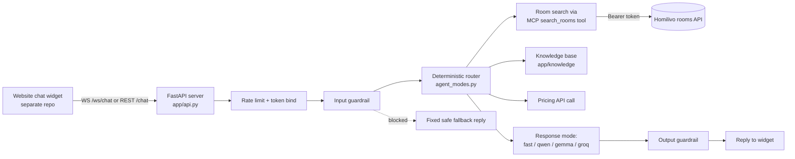

# Homilivo Chatbot (Homilivo_MCP)

Homilivo Chatbot is the conversational assistant behind Homilivo's room-search website. A tenant chats
in plain English (or Hinglish) to find rooms/PGs/apartments by city, budget, BHK and amenities, see
subscription-plan pricing for a city, and get answers about refunds, privacy and safety — all backed by
live calls to the Homilivo rooms API and a retrieval-based knowledge base; when nothing relevant is found
the bot says it does not have that information, rather than guessing. The repository holds the chatbot
backend, its evaluation tooling, and the knowledge base it answers platform questions from; the website
itself lives in a separate repository.

## Why it's useful

**For tenants:**
- Search for rooms by typing naturally ("2BHK in Jaipur under 15000"), including follow-ups and refinements.
- Ask what a Homilivo subscription plan costs in a given city and get current pricing, not a stale page.
- Get grounded answers to FAQ-style questions (refunds, how the platform works, privacy, safety) without
  waiting for human support.
- Keep chatting without re-authenticating or losing context mid-conversation (session memory, reconnect
  handling).

**For the Homilivo team:**
- A single backend that answers both the production chat widget and ongoing evaluation of a
  next-generation pipeline, so changes can be measured against a calibrated golden-eval set before they
  reach users.
- Guardrails (input/output filtering, rate limiting, secret-leak prevention) and observability
  (`/metrics`, `/health`, `/ready`) built in, so the bot can be monitored and safely iterated on.
- A documented path for updating the knowledge base's content without touching code.

## Components overview

| Component | Folder | Status | Description |
|---|---|---|---|
| Chatbot backend (v1) | [app/](app/) | Live path per docs; TODO(lead): confirm which backend the production website uses | FastAPI service (REST `/chat` + WebSocket `/ws/chat`) with a deterministic router, four response modes (templated `fast`, local-LLM `qwen`/`gemma` via Ollama, hosted `groq`), room search via an in-process MCP tool, a Chroma-based knowledge base, and input/output guardrails. |
| LLM-decision pipeline (v2) | [llm_approach/](llm_approach/) | In development / under evaluation | Self-contained rewrite: one structured LLM decision (Gemini by default; Groq is an optional fallback provider, off by default — see below) per turn, with code validating every slot before any action runs. Reuses `app/`'s logic by copying it (never importing), so it can be evaluated side by side with v1. Runs on its own port (8001) during evaluation. |
| MCP room-search tool | [app/server.py](app/server.py) | Live | Exposes `search_rooms` as an MCP tool over the Homilivo rooms API; called in-process by both `app/` and `llm_approach/` (the latter via its own copy in [llm_approach/tools/mcp_search.py](llm_approach/tools/mcp_search.py)). |
| Knowledge base (v1) | [app/knowledge/](app/knowledge/) | Live | Chroma-backed retrieval over markdown documents for platform/FAQ questions. |
| Knowledge base (v2) | [llm_approach/rag/](llm_approach/rag/) | Under evaluation | Separate Chroma collection and document set; see [llm_approach/README.md](llm_approach/README.md). |
| React demo frontend | [frontend-demo/](frontend-demo/) | Reference/demo client, not production | Used to exercise the WebSocket contract during development; the production chat widget lives in the website's own repository. |
| Evaluation tooling | [tests/](tests/), [llm_approach/eval/](llm_approach/eval/) | Live | Golden-set accuracy gates, scenario tests, RAG evaluation, security/robustness checks. |
| Operational scripts | [scripts/](scripts/), [llm_approach/scripts/](llm_approach/scripts/) | Live | Load testing, Redis-restart checks, server start scripts, document/content checks. |
| CI | [.github/workflows/ci.yml](.github/workflows/ci.yml) | Live | Runs the test suite and golden-eval gate on every PR and on push to `main` (see [Testing and CI](#testing-and-ci) for a caveat). |

**Website today:** this repository's docs describe `app/` (port 8000) as the live path and
`llm_approach/` (v2, port 8001) as a parallel pipeline being evaluated against the same golden sets before
any cutover, but nothing in this repository can confirm which backend the deployed production website is
actually pointed at right now. TODO(lead): confirm this.

The website frontend itself (`kangaroorooms/newkangaroorooms`) is a separate repository. It connects to
this backend through a WebSocket client (`chatbotWebSocket.ts` in that repo) that implements the contract
documented in [docs/WEBSOCKET_CONTRACT.md](docs/WEBSOCKET_CONTRACT.md); this repository does not document
that client's internals.

## Architecture



The `llm_approach/` (v2) pipeline follows the same shape with one LLM decision call in place of the
router + response-mode split. The provider is Gemini by default (`LLM_APPROACH_PROVIDER`, server-side
setting); Groq is only an optional fallback, and `LLM_APPROACH_FALLBACK_PROVIDER` defaults to empty
(`config.py:262,298-301` — unset means off), so Groq is never called unless that variable is explicitly
set to `groq`. The `mode` value the website sends per request (`"fast"`, `"qwen"`, etc., the same field v1 reads)
is read into v2 (`llm_approach/pipeline.py:521`, `turn_context.requested_mode()`) and logged for
observability, but it does not select the provider or change the decision path — v2 always uses the
provider configured on the server. See [llm_approach/README.md](llm_approach/README.md) for its own
diagram and details.

## Key features

- Natural-language room search (city, BHK, budget, amenities, "ideal for") against the live Homilivo API.
- Multi-turn conversation: refinements, follow-ups, sorting ("cheapest", "most expensive"), and a city-change
  confirmation flow so filters aren't silently dropped or merged.
- Subscription-plan pricing lookups by city, served from a live pricing API call.
- Grounded platform/FAQ answers (refunds, how it works, privacy, safety) from a retrieval-based knowledge
  base; when no matching content is found, the bot says it doesn't have that information instead of
  guessing.
- Four selectable response modes in `app/` (`fast` templated, `qwen`/`gemma` local via Ollama, `groq`
  hosted), with automatic fallback to `fast` if a model call fails.
- Input/output guardrails against prompt injection and credential/secret leakage.
- Per-IP and per-session rate limiting, with Redis-backed session storage optional for horizontal scaling.
- `/health`, `/ready`, `/metrics`, `/knowledge/health` for operational monitoring.
- A calibrated golden-evaluation suite that gates CI on measured accuracy, not aspirational targets.

## Project structure

```
app/                      v1 chatbot backend (live) — FastAPI server, router, response modes, guardrails
  api.py                   REST /chat, WebSocket /ws/chat, health/ready/metrics routes
  server.py                MCP server exposing the search_rooms tool
  experiments/agent_modes.py  Router + the four response modes (fast/qwen/gemma/groq)
  knowledge/                Chroma-backed knowledge base (documents/, store.py, answer.py)
  guardrails/               Input/output guardrails
  schemas/, embeddings.py, session_store.py, rate_limit.py, observability.py, ...
llm_approach/              v2 LLM-decision pipeline (under evaluation, not yet live)
  server_app.py             FastAPI server for v2 (port 8001)
  pipeline.py, responder.py, validators.py, actions/   Decision validation and action execution
  rag/                      v2 knowledge base and documents
  eval/                     Live/offline evaluation runners and reports
  tests/                    v2-specific tests
  README.md                 Full v2 reference (env vars, server behaviour, deployment)
tests/                     v1 test suite, golden set and eval runner (pytest tests/)
  golden_set.jsonl           Labeled golden evaluation dataset
  run_golden_eval.py          Overall golden-set accuracy gate (used by CI)
  test_golden_eval.py          Per-category calibrated accuracy gates (used by CI)
frontend-demo/             React/TypeScript demo client (development/reference only)
scripts/                   Operational scripts (load testing, legacy CLI)
docs/                      Architecture, runbook, WebSocket contract reference
.github/workflows/ci.yml   CI: test suite + golden-eval gate
docker-compose.yml          Local Redis for STATE_BACKEND=redis
requirements.txt            Base dependencies for the v1 backend, the tests and the v2 pipeline (installed
                             by CI and local setup); the Gemini SDK is split out into
                             llm_approach/requirements-gemini.txt (see Getting started)
```

## Getting started

### Prerequisites

- Python 3.13 (matches `.github/workflows/ci.yml`).
- Redis is **optional** — only needed if you set `STATE_BACKEND=redis`; `docker-compose.yml` starts a
  local instance. The default `STATE_BACKEND=memory` needs nothing extra.
- For `mode="qwen"` or `mode="gemma"`: a local [Ollama](https://ollama.com) daemon with `qwen3:4b` /
  `gemma3:4b` pulled. Not required for the default `fast` mode.

### Clone and set up a virtual environment

```bash
git clone https://github.com/kangaroorooms/Homilivo_MCP.git
cd Homilivo_MCP
```

Windows (PowerShell):

```powershell
python -m venv venv
.\venv\Scripts\Activate.ps1
pip install -r requirements.txt
```

macOS/Linux:

```bash
python -m venv venv
source venv/bin/activate
pip install -r requirements.txt
```

`requirements.txt` covers the v1 backend, the test suite and the v2 pipeline's non-LLM dependencies — but
not the Gemini SDK. If you're going to run v2 (`llm_approach/`) live, or its `smoke_gemini.py`, also
install the Gemini extra (needed because `LLM_APPROACH_PROVIDER` defaults to `gemini`; the v2 test suite
fakes this package in `llm_approach/tests/conftest.py`, so `python -m pytest llm_approach` passes without
it, but a live run or `smoke_gemini.py` fails with an `ImportError` if it's missing):

```bash
pip install -r llm_approach/requirements-gemini.txt
```

`llm_approach/requirements-mcp.txt` (the MCP search transport, also v2's default) needs no separate step —
its packages (`mcp`, `mcp-types`) are already pinned in the root `requirements.txt`.

One-line install for running v2 live:

```bash
pip install -r requirements.txt -r llm_approach/requirements-gemini.txt
```

### Configure the environment

```bash
cp .env.example .env
```

PowerShell:

```powershell
Copy-Item .env.example .env
```

Fill in real values in `.env` (never commit it — it's gitignored). Variable names, purpose and defaults
(`app/` v1 backend; see [llm_approach/README.md](llm_approach/README.md) for the v2-specific variables):

| Variable | Purpose | Default | Required |
|---|---|---|---|
| `KANGAROO_TOKEN` | Credential for the Homilivo rooms API; also the server-side fallback for the CLI debug tool and the `/chat-ui` demo page's token exchange. `/chat` callers can still supply their own bearer token. | — | Yes — startup refuses without it |
| `GROQ_API_KEY` | Needed only for `mode="groq"`. | — | Optional |
| `DEEPGRAM_API_KEY` | Used only by the frontend demo's voice input; not read by `app/`. | — | Optional |
| `HOMILIVO_API_TIMEOUT_SECONDS` | Per-attempt timeout calling the rooms API. | `10` | Optional |
| `HOMILIVO_API_MAX_ATTEMPTS` | Retry attempts for the rooms API (read-only GET). | `3` | Optional |
| `HOMILIVO_API_RETRY_BACKOFF_SECONDS` | Backoff base between retries. | `0.3` | Optional |
| `PRICING_API_URL` | Subscription pricing API endpoint. | `https://kangaroo-rooms-backend.onrender.com/api/tenant-subscriptions/pricing` | Optional |
| `RATE_LIMIT_ENABLED` | Turns rate limiting on/off. | `true` | Optional |
| `RATE_LIMIT_MAX_REQUESTS` / `RATE_LIMIT_WINDOW_SECONDS` | Per-IP rate limit budget. | `30` / `60` | Optional |
| `SESSION_TTL_SECONDS` | How long an idle session is kept. | `3600` | Optional |
| `SESSION_MAX_COUNT` | Max sessions kept in memory before the oldest is evicted. | `1000` | Optional |
| `SESSION_MAX_HISTORY_MESSAGES` | Transcript length cap per session. | `40` | Optional |
| `STREAM_CHUNK_DELAY_SECONDS` | Delay between streamed reply chunks. | `0.02` | Optional |
| `WS_HEARTBEAT_INTERVAL_SECONDS` | WebSocket idle ping interval. | `20` | Optional |
| `FEEDBACK_LOG_PATH` | Where `/feedback` submissions are appended. | `data/feedback.jsonl` | Optional |
| `STATE_BACKEND` | `memory` or `redis` session storage. | `memory` | Optional |
| `REDIS_URL` | Redis connection string (only used when `STATE_BACKEND=redis`). | `redis://localhost:6379/0` | Optional |
| `CHROMA_PERSIST_DIR` | Knowledge-base index location. | `data/chroma` | Optional |

### Start the server(s)

v1 backend (`app/`), port 8000:

```bash
uvicorn app.api:app --reload --port 8000
```

v2 pipeline (`llm_approach/`, under evaluation), port 8001 — PowerShell, from the repo root with the venv
active:

```powershell
.\llm_approach\scripts\start-server.ps1
```

or directly:

```bash
python -m uvicorn llm_approach.server_app:app --port 8001 --no-access-log
```

`--no-access-log` matters for v2: the WebSocket auth token travels in the URL query string.

### Health, readiness and a test message

```bash
curl http://localhost:8000/health
curl http://localhost:8000/ready
curl http://localhost:8000/knowledge/health
```

v2, if it's running:

```bash
curl http://localhost:8001/health
curl http://localhost:8001/ready
```

PowerShell note: Windows PowerShell 5.1 aliases `curl` to `Invoke-WebRequest`, which does not accept curl's
flags the same way. Use `curl.exe` (the real curl binary, if installed) to run the commands above as written,
or translate them to `Invoke-WebRequest`/`Invoke-RestMethod`.

```powershell
curl.exe http://localhost:8000/health
curl.exe http://localhost:8000/ready
```

Send a test message (BYOT — bring your own Homilivo token):

```bash
curl -X POST http://localhost:8000/chat \
  -H "Authorization: Bearer <your-kangaroo-token>" \
  -H "Content-Type: application/json" \
  -d "{\"message\": \"2BHK in Jaipur under 15000\", \"session_id\": \"test-1\"}"
```

For the WebSocket contract (`/ws/chat`, auth, event shapes, close codes), see
[docs/WEBSOCKET_CONTRACT.md](docs/WEBSOCKET_CONTRACT.md).

## Knowledge base

v1's documents live in [app/knowledge/documents/](app/knowledge/documents/) (markdown, indexed into a
Chroma collection under `CHROMA_PERSIST_DIR`, default `data/chroma`). v2 has its own separate documents
and index under [llm_approach/rag/documents/](llm_approach/rag/documents/) — see
[llm_approach/README.md](llm_approach/README.md) for the paragraph format the v2 chunker expects (one
chunk per blank-line-separated paragraph for FAQ-style documents) and the full replacement procedure.

To check a documents change in v2:

```bash
python -m llm_approach.rag.check_docs
python -m llm_approach.eval.rag.eval_rag
```

`check_docs` prints the chunks and tries sample questions offline; `eval_rag` reports top-1/top-3/MRR
accuracy per category and out-of-domain false positives.

## Testing and CI

Run the full v1 suite:

```bash
python -m pytest tests/ -q
```

Run a single file:

```bash
python -m pytest tests/test_knowledge.py -q
```

Run the v2 suite:

```bash
python -m pytest llm_approach -q
```

Run the golden-set accuracy gate directly:

```bash
python tests/run_golden_eval.py
```

CI (`.github/workflows/ci.yml`) runs on **every pull request** (against any base branch) and on **every
push to `main`**: it installs dependencies, runs `pytest tests/` (which includes the calibrated
per-category golden-eval gates in `tests/test_golden_eval.py`), then runs `tests/run_golden_eval.py`
(overall golden-set accuracy gate). Nothing in the job depends on a live Ollama instance or the real
Homilivo API — both are mocked (`tests/conftest.py` mocks the outbound Homilivo HTTP call; the LLM paths
are mocked wherever exercised).

**v2 is not covered by CI:** the workflow installs only `requirements.txt` and runs only the root
`tests/` suite plus the golden-eval gate — it never runs `llm_approach/tests` or the RAG evaluation in
`llm_approach/eval/rag/`. A regression in `llm_approach/` can merge without CI catching it. TODO(lead):
add a CI step that installs `requirements.txt` plus `llm_approach/requirements-gemini.txt` and
`llm_approach/requirements-mcp.txt`, then runs `python -m pytest llm_approach`.

**Correction from the previous README:** the workflow's push trigger targets a branch named `main`, but
this repository's remote (`origin`) has no `main` branch. The real flow, from merge history
(`git log --merges --oneline`) and ancestry (`git merge-base --is-ancestor`) on `master`, `origin/QA` and
`DEV`: feature branches (`fix/...`, `improve/...`, `experiment/...`, etc.) merge into **`DEV`** through
PRs — PRs #17, #23, #28 and #29 all land directly on `DEV` — and `DEV` is ahead of `QA`, which is ahead of
`master` (`master` is an ancestor of `QA`, which is an ancestor of `DEV`), consistent with `DEV` being
promoted down to `QA` and then to `master` in stages rather than every change going straight to `master`.
The pull-request trigger still runs for PRs against any base branch, so test coverage on PRs is
unaffected, but the push-to-`main` trigger will not fire for `DEV`, `QA` or `master` — the branches that
actually receive commits. TODO(lead): retarget the workflow's push trigger to `DEV` (and optionally `QA`
and `master`), or confirm `main` is an intended future default branch that simply doesn't exist yet.

**Branch protection:** add the `test` job from this workflow as a required status check for **`DEV`**,
the branch PRs actually target per the contributing workflow (GitHub repo Settings → Branches → branch
protection rule → "Require status checks to pass"), so a PR that fails tests or drops below a golden-eval
gate cannot be merged. Consider the same for `QA` and `master` if the team wants the gate re-checked at
each promotion stage.

**Flaky on a slow machine:** timing-sensitive tests (circuit-breaker cooldowns, rate-limit windows, the
Gemini/LLM turn-deadline tests in `llm_approach`) use real wall-clock sleeps and can intermittently fail
under heavy CPU contention; re-run them in isolation before assuming a regression.

## Troubleshooting

| Problem | Fix |
|---|---|
| Port already in use (8000 or 8001) | Another process is bound to it — stop it, or pass a different `--port` to `uvicorn`. |
| Gemini returns 503 or replies are slow (v2) | A `503 UNAVAILABLE` from Gemini comes from Google's side — the model is overloaded on the free tier — not from our own rate limiter. Our limiter and the per-turn deadline (`LLM_APPROACH_GEMINI_TURN_DEADLINE_S`) only decide how long the turn waits before giving up and answering from the rule-based fallback instead of hanging. Enable `LLM_APPROACH_METRICS=1` to see each turn's `error_class` (e.g. `RateLimitError`) in `eval/results/metrics.jsonl`. |
| Pricing or rooms API is slow on first call | Both run on Render and cold-start after idling; the warm-up step at startup (`LLM_APPROACH_WARMUP`, v2) mitigates this, but the first real request after a long idle period can still be slow. |
| Line-ending warnings from Git on Windows | Harmless. They come from `core.autocrlf=true` in your local Git config with no `.gitattributes` file in the repo to normalize line endings per file type. TODO(lead): add a `.gitattributes` file. |
| Knowledge base answers look stale after editing documents | The Chroma index is only rebuilt when the documents change and the server restarts; restart the server, or for v2 run `python -m llm_approach.rag.check_docs` to confirm the new chunks before restarting. |

## Known limitations

- The v2 pipeline (`llm_approach/`) has not completed live evaluation (see
  [llm_approach/PENDING.md](llm_approach/PENDING.md)); its accuracy numbers from stub-mode runs are not
  evidence of production accuracy.
- There is no voice input in the live `app/` backend; voice input exists only in the demo frontend via
  Deepgram and is not read by the backend.
- The rooms API has no area filter, so area searches fetch a fixed page of rooms and filter locally — this
  can miss matches beyond that page.
- v2's rule-based fallback (used when Gemini/Groq fails, times out, or returns invalid JSON twice) only
  handles room search; it does not answer knowledge-base or pricing/plan questions.
- v2's knowledge retrieval can return the wrong paragraph for some phrasings (for example "what plans does
  Homilivo have"-style questions).
- Messages about scams or fraud can be classified as out of scope by v2 rather than answered from the
  knowledge base.
- v2's knowledge documents (`llm_approach/rag/documents/`) are a draft v1 of the official content and are
  awaiting team-lead approval; they carry `verified: false` and `/metrics` reports them as
  `knowledge_unverified`.
- CI installs only `requirements.txt` and runs only the root `tests/` suite and the golden-eval gate;
  `llm_approach/tests` and the RAG eval are not run by CI today (see [Testing and
  CI](#testing-and-ci)). TODO(lead): install `requirements.txt` plus
  `llm_approach/requirements-gemini.txt` and `llm_approach/requirements-mcp.txt`, then run
  `python -m pytest llm_approach` as a CI step.

## Getting help

- This README, for setup and the overall repository layout.
- [llm_approach/README.md](llm_approach/README.md) for everything specific to the v2 pipeline (env vars,
  server behaviour, deployment).
- [llm_approach/docs/V2_PLAN.md](llm_approach/docs/V2_PLAN.md) for the v2 design plan.
- [llm_approach/eval/rag/README.md](llm_approach/eval/rag/README.md) for the RAG evaluation tooling.
- [docs/RUNBOOK.md](docs/RUNBOOK.md) and [docs/WEBSOCKET_CONTRACT.md](docs/WEBSOCKET_CONTRACT.md) for
  operational and integration reference.
- TODO(lead): where to file bugs/issues (issue tracker link) and which team channel to ask in. Do not use
  `support@homilivo.com` for developer questions — that address is for customer support.

## Maintainers and contributors

- S. Mohamed Faizal — AI intern, current maintainer.
- TODO(lead): team lead's name and contact.

## Contributing

- Branch from `DEV` for new work; one branch per task.
- Keep commits few and meaningful.
- Before opening a PR: run the full test suite (`python -m pytest tests/ -q` and, if touched,
  `python -m pytest llm_approach -q`), the relevant document check (`check_docs`) and evals if the
  knowledge base changed.
- Never commit `.env` or API keys.
- No push to a shared branch or merge without the team lead's approval.

## License

TODO(lead): no `LICENSE` file exists in this repository; add one or state the intended license.
